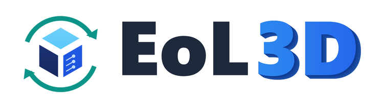
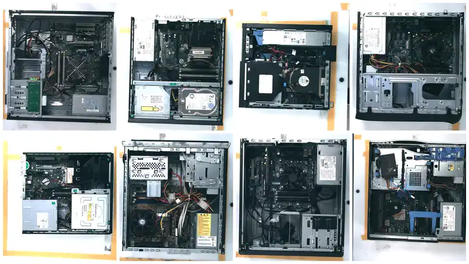
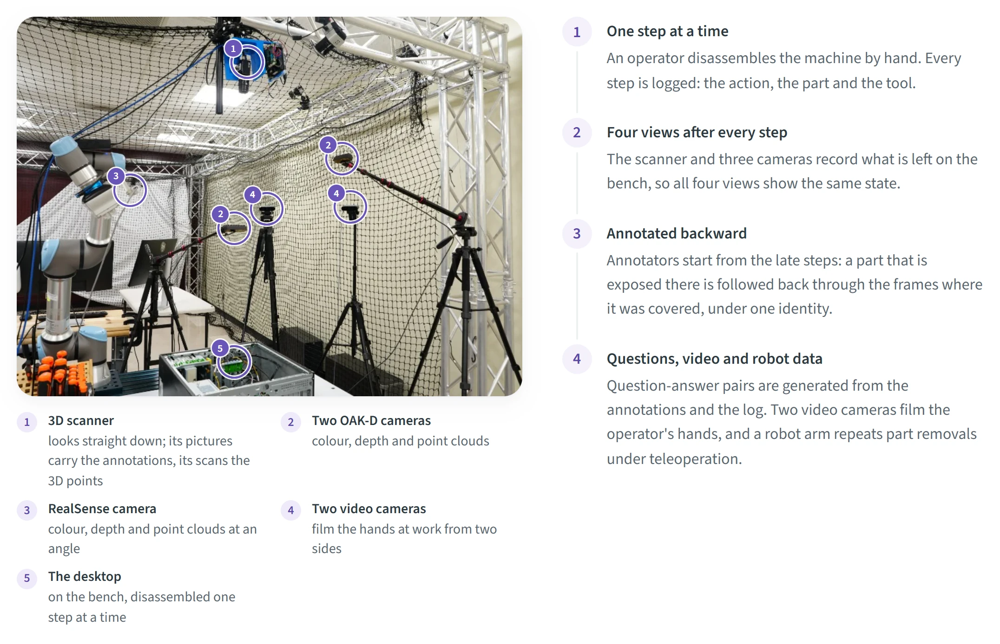
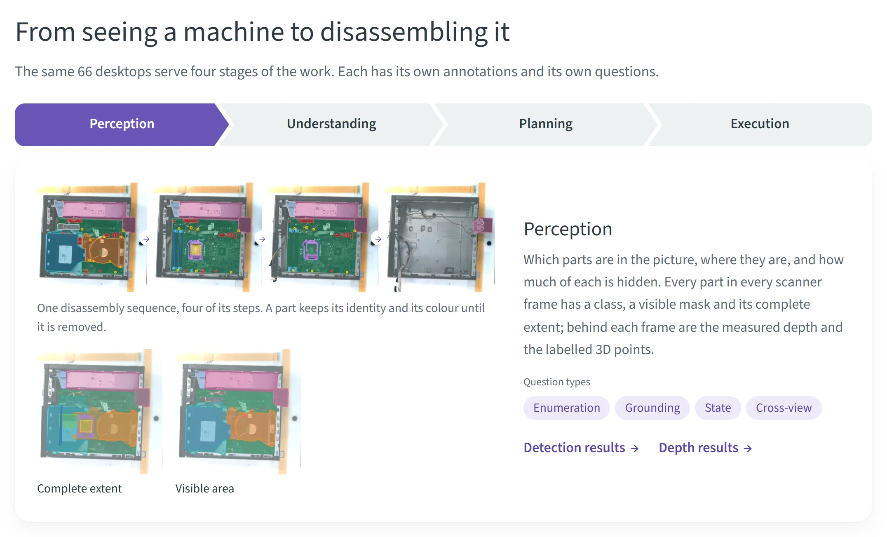

<h1 align="center">
  <a href="https://eol3d.github.io"></a>
</h1>

<p align="center">Step-by-step teardowns of end-of-life desktop computers</p>

<p align="center">
  <a href="https://eol3d.github.io"><b>Website</b></a> &nbsp;·&nbsp;
  <a href="https://eol3d.github.io/guide.html"><b>Guide</b></a> &nbsp;·&nbsp;
  <a href="https://huggingface.co/datasets/ChangChrisLiu/E3D-Desktop-Disassembly"><b>Data</b></a> &nbsp;·&nbsp;
  <a href="https://eol3d.github.io/#benchmark"><b>Benchmark</b></a> &nbsp;·&nbsp;
  <a href="https://eol3d.github.io/#explore"><b>3D explorer</b></a>
</p>

<p align="center">
  
</p>

Code for **EoL3D**, a dataset of 66 end-of-life desktop computers taken apart by hand, one step at a time. After
every step the machine is recorded from four fixed views; instance masks, part states, removal relations,
question-answer pairs, 3D reconstructions, operator video and robot demonstrations are built on those records.

- Website: <https://eol3d.github.io> (what the data is, an interactive teardown, results)
- Guide: <https://eol3d.github.io/guide.html> (every folder and file, tasks and scoring)
- Data: <https://huggingface.co/datasets/ChangChrisLiu/E3D-Desktop-Disassembly> (the repository still carries the
  dataset's earlier name, E3D-Desktop-Disassembly; it holds the same data)
- Annotation tool: <https://github.com/ChangChrisLiu/DataLabelToolForEoLDesktopDisassembly> (the desktop tool the
  annotations were made with, and the exporters behind every released folder)

## The dataset in two pictures

<p align="center">
  
</p>

<p align="center">
  
</p>

Both are sections of the [website](https://eol3d.github.io), where the stages can be opened one by one and a
teardown can be stepped through in 3D.

## What is here

| Folder | For | Contents |
|---|---|---|
| [`detection/`](detection/) | Detection and instance segmentation on the scanner view | COCO split builder (48 / 6 / 12 desktops), scorer with a self-test, training and prediction scripts for a YOLO segmentation model and a Mask R-CNN, Slurm templates |
| [`vqa/`](vqa/) | Visual question answering | self-check, chat converter (OpenAI, Qwen-VL and InternVL formats), scorer, reference lines (chance, most frequent answer, question without its image), run scripts for open and closed models |
| [`depth/`](depth/) | Depth from a single image | reference depth maps from the scanner's 3D reconstructions, scorer |
| [`reconstructions/`](reconstructions/) | The scanner's point clouds | a numpy reader, the parts of a step, a part's points; the guide to parts that are never fully in view |

The detection kit and the question-answering tools also ship inside the dataset (`benchmarks/level1/` and
`vlm/vlmpack_2026-11-05/tools/`), so a download of the data alone is enough to run them.

## Get the data

```bash
pip install "huggingface_hub>=1.0"            # provides the hf command
export DATA=$PWD/e3d                          # any folder
# everything is large (raw captures, video, robot data); take the folders a task needs:
hf download ChangChrisLiu/E3D-Desktop-Disassembly --repo-type dataset --local-dir "$DATA" \
    --include "annotations/scanner/*" --include "splits.json"                      # 9.5 GB: images, masks, states, relations
hf download ChangChrisLiu/E3D-Desktop-Disassembly --repo-type dataset --local-dir "$DATA" \
    --include "vlm/vlmpack_2026-11-05/*"                                           # 32 GB: question-answer pack
hf download ChangChrisLiu/E3D-Desktop-Disassembly --repo-type dataset --local-dir "$DATA" \
    --include "reconstructions/scanner/D13/*" --include "reconstructions/scanner/README.md"   # one desktop's point clouds
```

## Detection and instance segmentation

```bash
pip install -r detection/requirements.txt
python detection/make_coco.py --data-root "$DATA" --out work/coco          # train / val / test in COCO format
python detection/eval_coco.py --gt work/coco/test.json --selftest          # the scorer checks itself: AP must be 1.0
python detection/eval_coco.py --gt work/coco/test.json --pred my_predictions.json --out work/scores
```

Predictions are a COCO results list (`image_id`, `category_id`, `score`, `bbox`, `segmentation` as RLE on the full
1600 x 1600 frame). The test split is 12 desktops, 492 images, 12,930 parts. Training and prediction scripts for
the two baselines, and everything else, are in [`detection/README.md`](detection/README.md).

## Visual question answering

```bash
pip install -r vqa/requirements.txt
PACK="$DATA/vlm/vlmpack_2026-11-05"
# 0. the pack and the scorer agree: every gold answer scores 1.0
python vqa/vlm_selfcheck.py --truth $PACK/eval_v3/scan.jsonl $PACK/eval_v3/oak1.jsonl $PACK/eval_v3/oak2.jsonl \
    $PACK/eval_v3/multi.jsonl --out runs/selfcheck
# 1. chat requests for one unit (OpenAI style; also qwen, internvl)
python vqa/vlm_to_chat.py --export $PACK/eval_v3/multi.jsonl --format openai --image-root $PACK/images \
    --out runs/multi.openai.jsonl
# 2. run your model: one line per request, {"id": ..., "raw_text": "<the reply>"}
# 3. score
python vqa/vlm_score.py --truth $PACK/eval_v3/multi.jsonl --pred runs/my_model.multi.jsonl \
    --chat runs/multi.openai.jsonl --out runs/scores --name my_model-multi
```

Each record carries its desktop's split in `label.split`; the scorer reports every task with strict and lenient
parsing and intervals from a bootstrap over desktops. `vqa/vlm_run/` holds the scripts that run open models
(vLLM) and closed models through an API. Every script is described in [`vqa/README.md`](vqa/README.md).

## Depth from a single image

```bash
python depth/make_reference.py --data "$DATA" --out work/depth_ref         # needs reconstructions/scanner/D03 D04 D10 D11 D13 (S01)
python depth/eval_depth.py --ref work/depth_ref --pred work/my_model       # my_model/D03_S01.npy, ... : predicted depth in metres
```

The reference is the depth the scanner measured, at about half of the pixels of each 1600 x 1600 picture. The
scorer reports MAE, RMSE, AbsRel and the share of pixels within a ratio of 1.25 as predicted, the median scale
(predicted over measured), and MAE, RMSE, AbsRel and the share within 1.05 after dividing each prediction by that
scale. Other desktops and steps work the same way (`--desktops`, `--step`).

## The point clouds

```bash
python reconstructions/show_step.py --data "$DATA" --desktop D13 --step S01
python reconstructions/show_step.py --data "$DATA" --desktop D13 --step S01 --part cpu_cooler.fan.01 --out fan.ply
```

`reconstructions/scanner/D<NN>/S<nn>.ply` is the reconstruction of the capture whose picture is
`annotations/scanner/D<NN>/images/S<nn>.png`: `x y z` in millimetres in the scanner camera frame, `red green blue`,
and for every point the `instance` it lies on and its `category`. `eol3d_ply.py` reads it with numpy alone and
gives the pixel of each point. Parts that are never fully in view (a heatsink under its fan, the motherboard) are
taken with the removal order: [`reconstructions/HOW_TO_EXTRACT_3D_PARTS.md`](reconstructions/HOW_TO_EXTRACT_3D_PARTS.md)
and `parts3d.py`.

## Robot demonstrations

`raw/robot/` in the dataset holds 1,808 teleoperated demonstrations in two settings (parts on a fixture, parts on a
motherboard), one archive per episode with wrist and base camera images, robot states and actions at 30 Hz. They
need no code from this repository; the layout is described in the guide.

## The annotation tool

The desktop tool the annotations were made with, the exporters behind every released folder and their tests are in
<https://github.com/ChangChrisLiu/DataLabelToolForEoLDesktopDisassembly>.

## Licence

The code in this repository is released under the [MIT licence](LICENSE).

The dataset is not covered by it. The data is in pre-release and has its own terms:
[`DATA_TERMS.txt`](DATA_TERMS.txt). A data licence and a citation are coming soon.

Third-party packages keep their own licences. The YOLO baseline in `detection/` runs on the Ultralytics package
(AGPL-3.0); the Mask R-CNN baseline on torchvision (BSD-3-Clause); the scorer on pycocotools.
